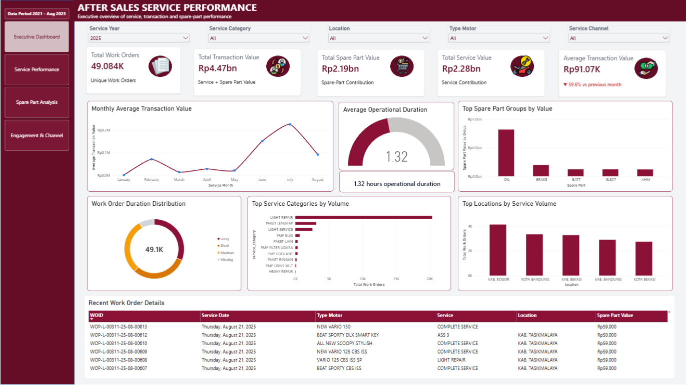

# Automotive After-Sales Business Intelligence

End-to-end data analytics project focused on automotive after-sales service performance, spare-part contribution, and customer engagement using Python and Power BI.

## Project Overview

This project transforms raw automotive after-sales data into actionable business insights. It explores service activity, operational duration, spare-part value contribution, and customer engagement patterns to support data-driven business decisions.

The project covers data preparation, exploratory data analysis, data modeling, KPI development, and interactive dashboard development.

## Objectives

- Analyze service performance across service categories and locations.
- Identify spare-part groups with the highest recorded transaction value.
- Explore operational duration across service activities.
- Evaluate promotion, booking, and service channel patterns.
- Develop interactive Power BI dashboards for business monitoring.

## Tools & Technologies

- **Python:** Data processing and analysis
- **Pandas:** Data cleaning, transformation, and aggregation
- **Google Colab:** Data analysis workflow
- **Excel:** Data inspection and preparation
- **Power BI:** Interactive dashboards and data visualization
- **DAX:** KPI calculations and business metrics

## Dashboard Showcase

### 1. Executive Dashboard

Provides an overview of Work Orders, transaction value, service value, spare-part contribution, operational duration, and service activity.

### 2. Service Performance Dashboard

Explores service demand, service category performance, operational duration, and location-level activity.

### 3. Spare-Part Analysis Dashboard

Analyzes spare-part transaction value, part group contribution, and spare-part usage patterns.

### 4. Engagement & Channel Dashboard

Examines promotion and booking patterns, engagement segments, and recorded service channel distribution.

## Key Findings

- **Service Performance:** LIGHT REPAIR recorded the highest service volume, with 20,377 Work Orders.
- **Spare-Part Contribution:** OIL was the leading spare-part group by recorded value.
- **Operational Duration:** Duration varied across the analyzed categories, highlighting activities that may warrant further investigation.
- **Customer Engagement:** Most Work Orders were recorded without promotion or booking.
- **Service Channels:** MOBILESOBI was the dominant explicitly recorded service channel, while many Work Orders had no channel information recorded.

These findings are descriptive and should be interpreted in the context of data coverage and recording completeness.

## Project Workflow

1. Data understanding and inspection
2. Data cleaning and preprocessing
3. Feature engineering
4. Exploratory Data Analysis (EDA)
5. Data modeling and KPI development
6. Power BI dashboard development
7. Business insights and recommendations

## Project Files

- **Final_Project.ipynb** — Python analysis notebook
- **final pro.pbix** — Power BI dashboard file
- **Muhammad Hafizh Rifandi Portfolio.pdf** — Project portfolio presentation

## Business Recommendations

- Monitor service volume and transaction value separately.
- Prioritize spare-part demand and value monitoring for high-contribution groups.
- Evaluate promotion and booking performance across engagement segments.
- Improve service channel recording and validate data coverage before interpreting trends.

## Author

**Muhammad Hafizh Rifandi**

Data Analyst | Business Intelligence

Interested in data analytics, business intelligence, dashboard development, and data-driven decision-making.
